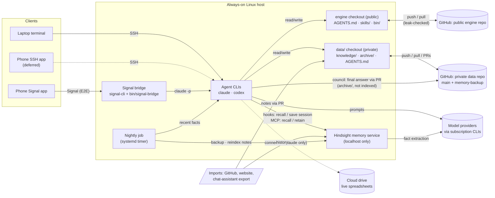
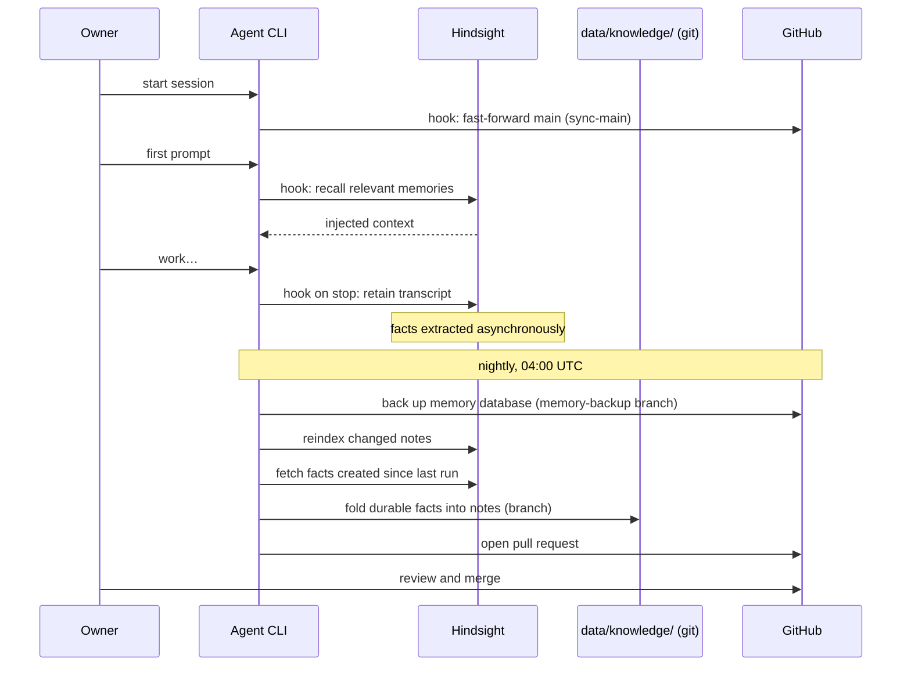
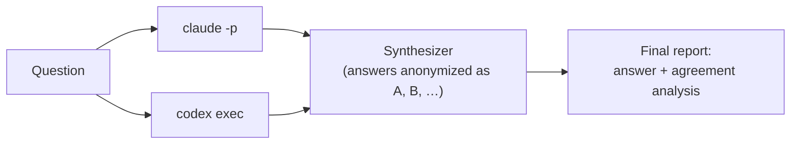

# Architecture

How the brain system is put together and why. For agent instructions see [AGENTS.md](AGENTS.md);
for setup details see [infra/](infra/).

## Goals

1. **Persistent knowledge** about the owner and their projects, which any agent can read and extend.
2. **Model-agnostic**: works with any agent CLI (Claude Code, Codex, Gemini, …), and can combine
   several models on one task.
3. **No pay-per-token usage**: every model call goes through official CLIs logged in with
   subscription plans, so usage is bounded by plan rate limits, not API billing.
4. **Terminal-first**: everything runs on one always-on host, reached over SSH, plus a Signal
   chat for the phone.
5. **Reuse over invention**: open formats (Markdown, `AGENTS.md`, Agent Skills, MCP) and existing
   tools (Hindsight) instead of custom infrastructure.

## Overview

## Engine and data: two repositories

The system is split so the design can be shared without the owner's data:

| | Engine (public) | Data (private) |
|---|---|---|
| Checkout | `~/brain` | `~/brain/data` (ignored by the engine's git) |
| Holds | `AGENTS.md`, `bin/`, `prompts/`, `skills/`, `infra/`, docs, `data.example/` | `knowledge/`, `archive/`, `runs/` (ignored), personal `AGENTS.md`, `brain.env`, `denylist.txt`, `memory-backup` branch |
| Changes | How the system works | Anything about the owner |
| PRs and issues | Only hand-made ones | Everything scripts open: reflect, import, council, job failures, weekly review |

- **Where a change lands is decided by the file it touches**, so daily use updates both repos
  without any routing step: a new fact is a commit in `data/`, a script fix a commit in the
  engine. A change with both parts is two commits.
- **Personal settings come from the data repo.** Scripts source `bin/brain-env.sh` (Python:
  `bin/brainenv.py`), which finds `data/` and loads `data/brain.env` (owner name, Hindsight bank,
  data repo name) and points `gh` at the data repo (`GH_REPO`). Prompt templates say `{{OWNER}}`.
  Agents read the engine's `AGENTS.md`, which tells them to read `data/AGENTS.md` too (`CLAUDE.md`
  and `GEMINI.md` import both).
- **Leak guard.** The engine's git hooks (`.githooks/`, enabled with
  `git config core.hooksPath .githooks`) run `bin/leak-check` on every commit and push. It blocks
  any string in `data/denylist.txt` (names, email, phone, people, places), common secret formats,
  and data-repo paths, in diffs, file names, commit messages and author identity. The denylist
  lives in the private repo, so it can't leak itself.
- **Search.** `.ignore` re-includes `data/` for ripgrep (the agents' Grep/Glob tools) while git
  keeps ignoring it.
- **New owners** run `bin/init-data "Name" owner/brain-data`, which copies `data.example/`, fills in
  the settings and creates the private repo.

## Components

### 1. Knowledge graph (`data/knowledge/`), the source of truth

Plain Markdown notes with YAML frontmatter (`type`, `tags`, `related`, `updated`), linked with
`[[wikilinks]]`. One note per entity: the owner (`me/`), projects, people, organizations,
topics, plus a dated journal. Being plain text in git, it is human-readable, diffable,
reviewable, editable in any editor (or Obsidian), and readable by any model without tooling.

The graph is deliberately **lean and current**: active projects, live interests and durable
preferences. Historical detail stays in Hindsight, where it can be recalled without cluttering
the notes. Some data has a **live source** instead of a note: spreadsheets in the owner's cloud
drive (listed in `data/AGENTS.md`) are authoritative, and notes only point to them.
Claude Code reads them through its cloud-drive connector; other agents report that they lack
access rather than fall back on stale figures.

How notes change:

| Path | Trigger | Review |
|---|---|---|
| In-session edit | The owner asks ("remember …"), or the agent records a durable fact or decision | Happens in the conversation; committed and pushed straight to `main`, and the agent reports what it changed |
| Nightly reflect | Automatic, daily | Proposed as a pull request; merged by the owner |
| Import | `bin/import` on a folder of source material | Proposed as a pull request; merged by the owner |
| Direct edit | The owner, in any editor (e.g. github.dev) | — |

The host's clones stay in step with GitHub both ways. Every Claude Code or Codex session starts by
fast-forwarding `main` in both repos (`bin/sync-main`, a SessionStart hook; skipped off `main` or with
uncommitted changes, and it reindexes Hindsight if notes changed), so edits and merges made on
GitHub are visible before anything is read. Every automated change arrives as a PR from its own
branch (`reflect/…`, `import/…`, `council/…`); GitHub deletes the branch on merge, and
`sync-main` then deletes the merged local copy, so only `main` and `memory-backup` persist. The nightly job and imports rebase any leftover local
commits onto GitHub's `main` and push them, so the two never diverge.

### 2. Agent instructions: one canonical file

`AGENTS.md` holds all instructions: layout, memory protocol, note format and rules. Tool-specific
entry points only import it (`CLAUDE.md` and `GEMINI.md` contain `@AGENTS.md`; Codex reads
`AGENTS.md` natively). Switching models means running a different CLI in the same directory.

Shared **skills** (`skills/<name>/SKILL.md`, the Agent Skills format) are linked into each
CLI's skill directory, so a workflow written once works with every agent.

### 3. Hindsight, the derived memory index

[Hindsight](https://github.com/vectorize-io/hindsight) runs as a local service and turns text
into facts, entities and relationships, with semantic, keyword, graph and temporal recall.
It is a **derived index**: everything durable ends up in `data/knowledge/`, and the index can be
rebuilt from the repo.

Configured lean to fit a 1 GB host (~300–450 MB resident, plus ~1.1 GB of cold pages in swap; see `infra/hindsight/`):

| Concern | Choice |
|---|---|
| Fact extraction LLM | Claude Code provider (subscription), small model, low concurrency |
| Embeddings | Local ONNX model, no PyTorch |
| Reranking | Reciprocal rank fusion, no neural reranker |
| Storage | Embedded Postgres |
| Exposure | Bound to localhost; reached by agents through MCP |

A per-bank *retain mission* steers extraction (names, what counts as durable, no secrets).

What the bank holds, by document type:

| Document id prefix | Source | Added by |
|---|---|---|
| `conversation:` | Claude Code / Codex sessions on the host | session hooks |
| `note:` | `data/knowledge/` notes (id `note:knowledge/<path>`) | `bin/reindex` |
| `claude-chat:` | Chat-assistant history export (owner's messages, attachments, the assistant's summary; not its replies) | `bin/prep-claude-export --retain` |
| `claude-memory:` | The chat assistant's own memory export (summary, per-project memory, memory files) | `bin/prep-claude-export --retain-memory` |

**Backups:** the database is dumped nightly as plain SQL to the orphan branch `memory-backup`
of the private data repo (`bin/backup-memory`). Plain text lets git store daily deltas (the script
runs `git gc` after each dump, since git would otherwise keep every ~20 MB dump whole), and
the branch keeps `main`'s history and clones free of dumps. Restore steps are in
`infra/hindsight/`.

### 4. Session memory loop

- **Hooks** (Hindsight coding-agents plugin) run in both Claude Code and Codex: a plain recall
  (no LLM call, so it's fast enough for a small host) is injected on the first prompt, and the
  transcript is saved each time the agent replies. The plugin's knowledge-pages prompts are
  turned off: the per-turn one in config, the SessionStart one by `bin/hindsight-hook-filter`.
- **One MCP server**: `hindsight-memory`, Hindsight's own endpoint, gives agents explicit
  `recall` / `retain` / `reflect` tools. The plugin's own `hindsight` server only serves
  knowledge pages, which are unused, so it is removed (Claude Code) or disabled (Codex) rather
  than started with every session. Agents are told to recall with several specific queries,
  since ranking without a neural reranker is weak for broad ones.
- **Opting out**: `private` starts a session with saving disabled (recall still works);
  `forget` deletes an already-saved session and every fact derived from it.
- **`bin/reindex`** keeps Hindsight in sync with `data/knowledge/`: one document per note, updated
  incrementally by content hash; removed notes are deleted from the index.
- **`bin/nightly`** closes the loop: new facts from host sessions are folded into `data/knowledge/`
  by an agent on a branch, and proposed as a pull request. Facts derived from the notes
  themselves, from imported history, and Hindsight's own consolidated observations are skipped,
  so the PR contains only what's genuinely new. Automated changes never reach `main` without the
  owner's review. Each run is logged to `data/runs/`; a failed run (or failed backup) opens or
  comments on a "Nightly failed" issue on the data repo, so a broken night doesn't look like a quiet one.

### Weekly review (`bin/weekly-review`)

Once a week (Sunday, systemd timer) a headless Claude run with web access checks whether the
system has fallen behind. It answers three questions: are the agents on current models and the
tools on current releases; has anything in agent memory and context management appeared that
should change this design; and are there unused efficiency gains. The script first gathers host
facts with plain shell: pinned models and models seen in session logs, installed vs. latest
versions, service memory, swap and restarts, auth expiry, recent job results. The model judges
those facts against sources it must link, and is given last week's report so it reports only
what changed. The result is an issue on the data repo labelled `weekly-review` (recommendations, not
edits; the repo is never touched), which supersedes and closes the previous one. A week with
nothing new only adds a comment to the open issue.

### Imports

`bin/import <dir> <label>` turns a folder of source material into notes: an agent reads it,
edits `data/knowledge/` on a branch (applying the "current over historical" rule) and opens a pull
request. Raw material stays in the git-ignored `data/runs/`. Suited to code repositories, a
personal website, and for a chat-assistant data export, whose history and memory also went
into Hindsight (`bin/prep-claude-export`).

### 5. Multi-model council (`bin/council`)

Members run in parallel (one after the other when started by `bin/council-bg`, which sets
`COUNCIL_SERIAL=1`: a background run sits outside the Signal bridge's one-at-a-time lock, so
two model CLIs next to a Signal reply would push the host deep into swap), read-only, from the repo root, so they share the same instructions,
notes and memory tools. The synthesizer sees the answers anonymized (so it can't favour its
own model) and produces:

- the merged **answer**, with single-source unverifiable claims flagged;
- an **agreement analysis** used as an uncertainty estimate: a claim-by-claim table
  (✓ / ✗ / –per model), an agreement score, a similarity rating, a confidence level, and how
  each disagreement was resolved. Agreement that may stem from a shared source counts as
  weaker evidence than independent agreement.

Model names are restored in the report after synthesis. Raw outputs are kept in `data/runs/`
(git-ignored). The run then opens a PR on the data repo containing only the final report, as
`archive/council/<date>-<slug>.md`. The PR is made on branch `council/<timestamp>-<slug>`
from a temporary worktree, so the working checkout is never touched. Merging the PR archives
the answer. `archive/` is deliberately outside `knowledge/`, so `reindex` never puts it in
Hindsight, nightly reflect never edits it, and agents are told not to treat it as a source.
This keeps old answers from feeding back into new ones. Closing the PR discards it. `--no-pr`
skips this step; if the PR can't be opened, the run only warns. Council calls disable the memory
hooks so they don't pollute the bank, but members can still query memory through
`hindsight-memory`.

### 6. Host and access

- One small Linux VPS (1 vCPU, 1 GB RAM + swap), always on.
- SSH with public-key authentication only; passwords, X11 and agent forwarding disabled; the
  firewall (UFW) allows only SSH; fail2ban bans brute-force sources. Root is restricted to
  key-only login for the provider's web console. No VPN or overlay network. Config files are in
  `infra/host/`.
- Agents and services run as a dedicated user (passwordless sudo, for maintenance); optional
  persistent sessions via `tmux`.
- GitHub access via the GitHub CLI; the engine repo can be public, the data repo is private.
- `/tmp` is a RAM-backed tmpfs (half of RAM), so large temporary files go to disk instead
  (`brain-signal.service` points signal-cli's ~190 MB native-library unpack at `~/.cache/`).
  The systemd journal is capped at 200 MB.

### 7. Phone access over Signal (`bin/signal-bridge`)

brain has its own Signal number. `signal-cli` runs as a daemon (`brain-signal.service`) exposing
JSON-RPC on a local socket; `bin/signal-bridge` (`brain-signal-bridge.service`) reads incoming
messages and answers only the owner, ignoring everyone else.

- Each message runs a headless `claude -p` in the repo, so memory hooks, notes and MCP tools
  work as in a terminal session. Headless runs can't approve permissions, so the bridge
  allows a fixed tool set: repo read/edit, Hindsight, read-only Drive, web, git (both repos).
- **One conversation per chat**: the direct chat and each Signal group (the owner plus brain's
  number, one per topic, e.g. "Health", "Investments") have their own Claude session, created on
  the first message. Session IDs are kept in `~/.local/state/brain/signal-session.json`.
  `/new` and `/private` reset only the chat they are sent in.
- Messages are handled **one at a time** across all chats: each run takes a few hundred MB,
  and parallel runs would push the 1 GB host into swap.

## Design decisions

| Decision | Rationale |
|---|---|
| Markdown in git as source of truth, Hindsight as index | Human-reviewable, portable, survives tool changes; the index is disposable and rebuildable |
| Subscription CLIs instead of APIs | No per-token billing; the CLIs are also full agent harnesses (tools, MCP, hooks) |
| `AGENTS.md` canonical + import stubs | One set of instructions for every model |
| PR-gated nightly updates and imports | Automated memory consolidation without silent drift in the source of truth |
| In-session edits pushed directly | The owner is present and asked for (or sees) the change; a PR would only add friction |
| Lean, current notes; history in Hindsight | Notes stay readable and trustworthy; detail is still recallable |
| Live sources over copied figures | Spreadsheets change; copies in notes or memory go stale silently |
| Memory backups as plain SQL on a separate branch | Off-host and free, git-friendly deltas, `main` stays clean |
| Recall-mode injection over reflect | Reflect (an LLM call) timed out on a 1 vCPU host; plain recall is sub-second |
| Claude Code auto memory off | One memory (notes + Hindsight) for every agent; no hidden per-tool store outside git and backups |
| Lean Hindsight config | Fits a low-cost host; reranking and heavy ML runtimes add little at personal scale |
| Anonymized synthesis + agreement analysis | Reduces self-preference bias; turns model (dis)agreement into an uncertainty signal |
| Council answers archived outside `knowledge/`, via PR | Kept for reference after review, but not indexed or used as a source, so past model output doesn't get treated as fact |
| Signal bot for phone access, one `claude -p` per message | End-to-end encrypted (personal data), unlike Telegram; no business-API or ban risk, unlike WhatsApp; no permanently running Claude session, unlike Remote Control |
| Signal groups as topic threads, replies serialized | Separate conversations without config (a new group is a new thread); serializing keeps RAM flat however many groups exist |
| Engine and data in separate repos | The design can be public while the data stays private; the file touched decides the repo, so nothing has to be filtered or mirrored |
| Single cheap VPS over home hardware or free tiers | Always on, simple, predictable; can be resized or moved since everything is in git |

## Repository layout

| Path | Contents |
|---|---|
| `AGENTS.md` | Canonical agent instructions |
| `ARCHITECTURE.md` | This document |
| `data/` | Private data checkout (separate repo): `knowledge/` (notes, templates, journal), `archive/council/` (final council answers, not used for retrieval), `runs/` (raw outputs, git-ignored), personal `AGENTS.md`, `brain.env`, `denylist.txt` |
| `data.example/` | Skeleton of a data repo, used by `bin/init-data` |
| `skills/` | Shared agent skills |
| `prompts/` | Prompt templates (council synthesis, nightly reflect, weekly review) |
| `bin/` | `council`, `council-bg`, `private`, `forget`, `reindex`, `nightly`, `backup-memory`, `import`, `prep-claude-export`, `signal-bridge`, `sync-main`, `weekly-review`, `init-data`, `leak-check`; shared setup in `brain-env.sh` / `brainenv.py` |
| `.githooks/` | Commit and push hooks that run `leak-check` |
| `infra/` | Service units (nightly, weekly review, Signal), Hindsight config, host hardening, rebuild instructions |

## Limits and next steps

- RAM is the main constraint; resize the host if concurrent agents start swapping heavily.
  While Hindsight is ingesting, the single CPU is busy and recall slows down.
- Recall ranking is weak for broad queries (no neural reranker); a light reranker is an option
  after a resize.
- Fact extraction uses a small model; its phrasing is steered by the retain mission but not
  guaranteed.
- `forget` can't reach git: facts already in a nightly PR or in the `memory-backup` history stay
  there.
- Only Claude Code can read the cloud-drive live sources; other agents answer without them.
- Over Signal, anything outside the bridge's tool set (running scripts, restarting services)
  needs SSH. signal-cli must be updated every few months, as Signal rejects old clients; the
  nightly job opens an issue when a new release is out, but installing it is a manual step.
